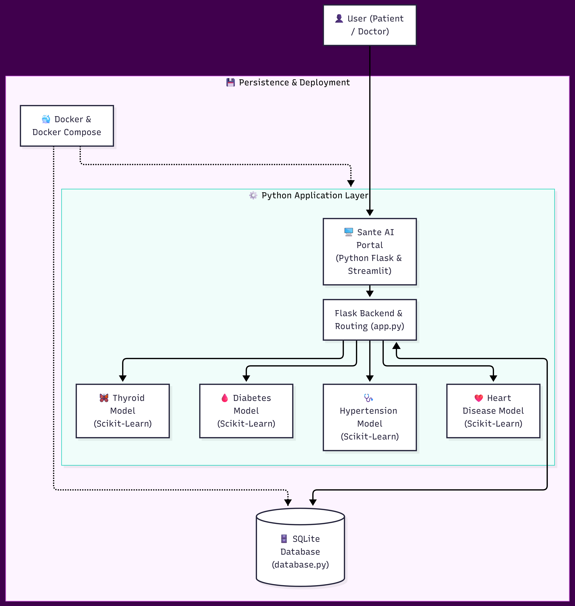
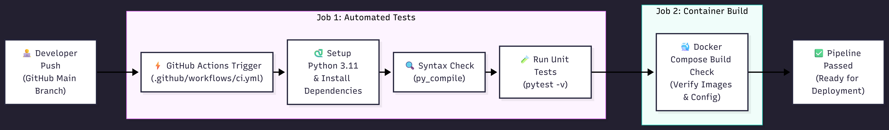
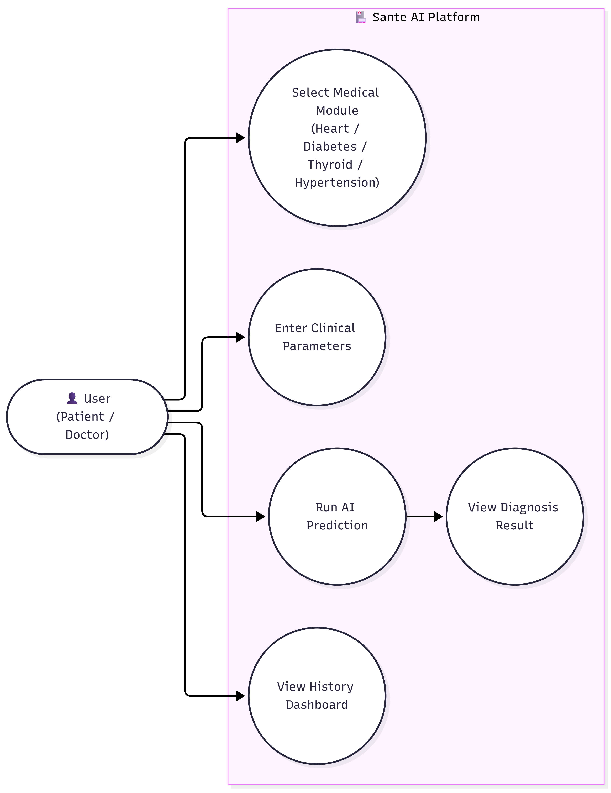

# 🏥 Sante AI — Intelligent Multi-Disease Diagnostic Platform

Sante AI is a web-based medical decision-support platform built with Python and Streamlit. It integrates Machine Learning models (scikit-learn) with a local SQLite database (sante_ai.db) to assist in early risk assessment across four chronic conditions, backed by an automated DevSecOps CI/CD pipeline.

---

## 🩺 Clinical Diagnostic Modules

| Module | Clinical Indicators & Inputs | ML Engine |
| :--- | :--- | :--- |
| ❤️ Heart Disease | Age, sex, chest pain type, resting blood pressure, cholesterol, fasting blood sugar, ECG results, max heart rate | scikit-learn Classifier |
| 🩸 Diabetes | Pregnancies, glucose level, blood pressure, skin thickness, insulin, BMI, diabetes pedigree function, age | scikit-learn Classifier |
| 🦋 Thyroid Disorder | TSH, T3, TT4, T4U, FTI hormone levels & clinical history | scikit-learn Classifier |
| 💓 Hypertension | Systolic/diastolic blood pressure, BMI, heart rate, lifestyle & metabolic parameters | scikit-learn Classifier |

---

## 🏗️ System Architecture & UML Diagrams

### System Architecture

### DevSecOps CI/CD Pipeline Architecture

### Use Case Diagram

---

## 🔄 DevSecOps CI/CD Workflow (GitHub Actions)

Every push or pull_request to the main branch automatically triggers .github/workflows/ci.yml, executing three automated stages:

1. **Automated Testing & Syntax Check (Pytest):** Verifies Python compilation (app.py, database.py) and executes unit/functional tests in tests/.
2. **Container Build Verification (Docker Compose):** Validates multi-container image building to guarantee environment parity.
3. **Static Application Security Testing (Bandit SAST):** Scans the codebase for high-severity security vulnerabilities before deployment.

---

## 🚀 Quick Start Guide

### Option 1: Run with Docker Compose (Recommended)
git clone [https://github.com/sara-bettayeb/sante_ai.git](https://github.com/sara-bettayeb/sante_ai.git)
cd sante_ai
docker compose up --build
Then open your browser at: http://localhost:8501

### Option 2: Run Locally (Python Virtual Environment)
git clone [https://github.com/sara-bettayeb/sante_ai.git](https://github.com/sara-bettayeb/sante_ai.git)
cd sante_ai
python -m venv venv
# On Windows:
venv\Scripts\activate
pip install -r requirements.txt
streamlit run main_portal.py
---

## 👩‍💻 Project Team — Master 1 Information Security (2026–2027)
* Sara Bettayeb (@sara-bettayeb) — Heart Disease Diagnostic Module, Database Integration, DevSecOps CI/CD & Security Pipeline
* Malak (@malakbgdd) — Diabetes Diagnostic Module & Automated Unit Testing (Pytest)
* Ferial (@ferial04) — Thyroid Disorder Diagnostic Module & UML System Modeling
* Maya — Hypertension Diagnostic Module